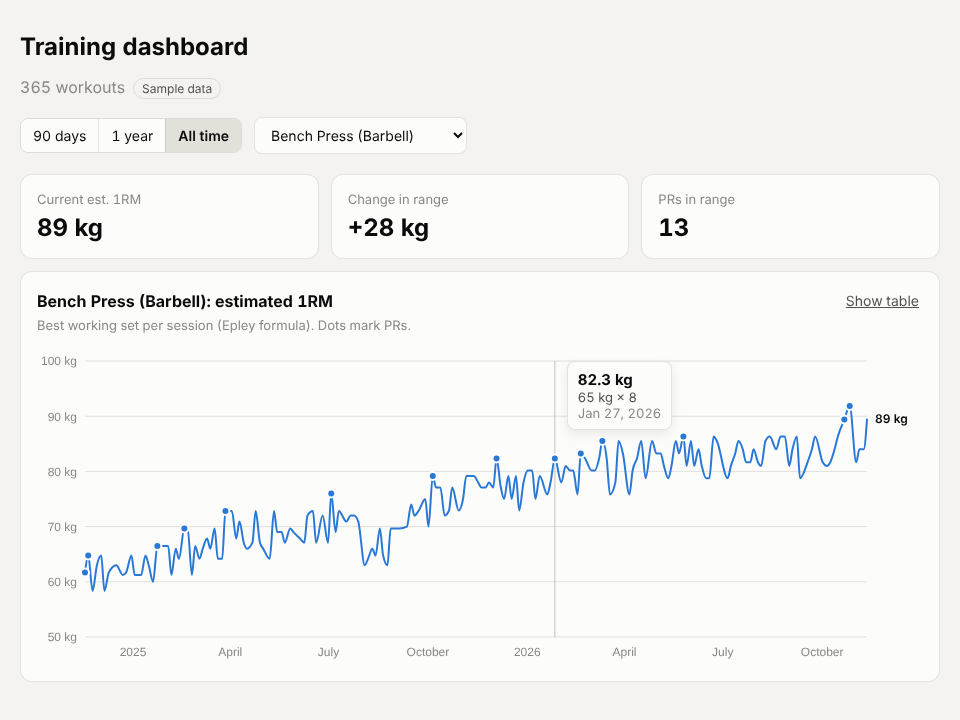

# Training Log for Hevy

Interactive charts of your full [Hevy](https://www.hevyapp.com/) workout history, with no 3-month or 1-year limit. Built with React, TypeScript and D3.



## Features

- **Every exercise you've logged,** each charted by the measure its type supports:
  - estimated 1RM (Epley formula, best working set per session) for weight-and-reps lifts;
  - heaviest set for weighted exercises;
  - most reps for bodyweight ones;
  - longest time for timed ones;
  - longest distance for cardio.
- **Overview:**
  - your main lifts as a tracklist, with PRs starred;
  - consistency, as sessions this month against your monthly average, plus a year of training days;
  - balance across muscle groups;
  - your latest workouts.
- **Exercises:** search, filter by kind and sort hundreds of exercises, with a page and progress chart for each.
- **Balance:** working sets per week for every muscle group and muscle, with under-trained groups flagged, and each group week by week.
- **Calendar:** every month in the range as a calendar, newest first, with a dot for each training day. Pick a day to see its workouts: start time, length, and each exercise's top set.
- **Activity:** your steps, distance, active calories, exercise minutes and time asleep, month by month, from an Apple Health export. Each measure has a page with a chart, yearly marks and a table. At the top, a "Last 4 weeks" card compares the four weeks before your export with the 12 months before them, for training days and each measure. Needs one import (see [Apple Health](#apple-health)).
- Date ranges (90 days / 1 year / all time) that apply to every view.
- lb by default, or kg; remembered per browser. Distance on the Activity tab follows it (lb shows miles, kg shows kilometers).
- A crosshair tooltip with keyboard support (focus the chart, then use ←/→), plus a table view of every chart.
- Light and dark mode: follow the system, or pick one in the header (remembered per browser).
- A layout that works on phones.
- Works without an account, using a generated sample dataset.

## Quick start

```bash
npm install
npm run dev
```

The repo includes a generated sample dataset (`public/data/sample.json`), so the dashboard works right away. It also includes made-up health data (`public/data/sample-health.json`). `npm run sample` regenerates both files.

### Use your own data

Requires Hevy Pro. Create an API key at <https://hevy.com/settings?developer>, then copy `.env.example` to `.env`, paste the key after `HEVY_API_KEY=`, and run:

```bash
npm run sync   # → data/hevy.json (git-ignored, never built into dist/)
npm run dev
```

`.env` is git-ignored. To pass the key without a file, run `HEVY_API_KEY=your-key npm run sync`. A key set in the environment wins over `.env`.

If `hevy.json` exists the dashboard uses it; otherwise it falls back to the sample.

The first sync downloads everything. Later syncs fetch only what changed since the last one (new, edited and deleted workouts), and print how many. To download everything again, run `npm run sync -- --full`. Keep the `--`: without it npm keeps the flag for itself and the script never sees it. Nothing is written to `data/hevy.json` until every request has succeeded, and the file is replaced in one step, so a failed sync leaves the previous data intact.

`npm run sync` exits with a code that says why it failed. Kingdom Keys (a home server) runs it nightly, discards the output and reads only this code, so keep the values stable:

| Exit code | Meaning |
|---|---|
| 0 | Synced |
| 1 | Anything else (including no `HEVY_API_KEY` in the environment or `.env`) |
| 20 | Hevy rejected the key (401 or 403) |
| 21 | Still rate-limited after retrying, or Hevy asked for a long wait |
| 22 | Couldn't reach Hevy (offline, DNS or connection failure) |
| 23 | Hevy answered with some other error, or with a response the sync doesn't recognize (`npm run sync -- --full` gets past it) |
| 24 | Couldn't write `data/hevy.json` |

#### Apple Health

The Activity tab reads a file you make from an Apple Health export. It is optional, and the other tabs work without it.

1. On your iPhone, open Health, tap your picture, then **Export All Health Data**. It takes a few minutes.
2. AirDrop the zip to your Mac, or save it to Downloads.
3. Run:

```bash
npm run health -- ~/Downloads/export.zip   # → data/health.json (git-ignored, never built into dist/)
npm run dev
```

The export is a snapshot, so the data is current to the day you exported. To update it, export again and re-run the command. Each run replaces `data/health.json`.

What it does with the export:

- It streams `export.xml` straight out of the zip, without unpacking it. It reads only steps, walking and running distance, sleep and the daily activity summaries. Every other type in the export is skipped and nothing else is kept. Your medical records (`export_cda.xml` and the clinical files) are never opened.
- iPhone and Watch both count steps, distance and sleep. It keeps the larger of the two for each hour of steps and distance, and counts overlapping sleep once, so nothing is counted twice.
- Sleep means time asleep. Time in bed and awake time don't count. A night counts toward the day you wake up.
- Active calories and exercise minutes come from the Watch, so they start the first day you wore one. Days without the Watch are left out rather than shown as zero.
- It prints progress and a summary of the days and date ranges it wrote, never your figures.

The demo shows made-up health data only when the Hevy data is the sample too. With your own Hevy data and no import, the Activity tab explains how to import.

The MCP server doesn't read health data.

## Ask Claude about your training

A small local [MCP](https://modelcontextprotocol.io) server lets Claude answer questions like "is my squat still going up?", "what have I neglected this month?" or "how does this year's bench compare with last year's?". It reads your synced `data/hevy.json` and computes every figure with the same `src/core` code as the dashboard, so an answer in chat matches what the dashboard shows.

### Setup

**Claude Code:**
1. Run `npm install`, then `npm run sync` (see [Use your own data](#use-your-own-data)). To let Claude sync for you later, put your key in `.env` (copy `.env.example`; the file is git-ignored). The desktop app needs nothing extra.
2. Open Claude Code in this folder.
3. Approve the `hevy-viz` server when asked. The committed `.mcp.json` registers it.

**From another folder:**

```bash
claude mcp add hevy-viz -- /absolute/path/to/hevy-viz/node_modules/.bin/tsx /absolute/path/to/hevy-viz/mcp/server.ts
```

The ask-before-sync rule only applies in this folder. For the server in another project, add `mcp__hevy-viz__sync_now` under `permissions.ask` in that project's `.claude/settings.json` or in your `~/.claude/settings.json`, or Claude could sync without asking.

**Claude desktop app:** add the server to `claude_desktop_config.json` and restart the app:

```json
{
  "mcpServers": {
    "hevy-viz": {
      "command": "/absolute/path/to/hevy-viz/node_modules/.bin/tsx",
      "args": ["/absolute/path/to/hevy-viz/mcp/server.ts"],
      "env": { "HEVY_VIZ_TZ": "America/Chicago" }
    }
  }
}
```

Use the repo's own `tsx`, as above, rather than `npx tsx`. Outside this folder, `npx` can't find it and may try to download it.

### What it can answer

| Tool | Answers |
|---|---|
| `find_exercises` | Which exercises you've logged, searched by name, with sessions, last done and all-time best |
| `exercise_progress` | How one exercise is going: best ever, latest, change, PRs, weekly or monthly bests and long breaks |
| `main_lifts` | Your main lifts, as on the overview: best set, change, latest estimated 1RM and PRs |
| `consistency` | Sessions this month against your average, sessions per week, weeks trained and your longest break, and training time (total and per training day, optionally week by week) |
| `balance` | Working sets per week for each muscle group (light ones flagged) and your busiest muscles; with `series`, week by week |
| `recent_workouts` | Your training log: the latest workouts, or every workout in a date range (up to 40), with each workout's length and each exercise's top set |
| `sync_now` | Pulls your latest workouts from Hevy, so you can ask about one you just logged |

Every tool that looks at a period takes `90d`, `1y` (the default) or `all`, or your own `from` and `to` dates, so Claude can compare this year with last.

### Good to know

- **Freshness:** answers are as current as your last sync. Every answer carries the sync time, and Claude mentions it when the data is more than a few days old. A sync while a conversation is open is picked up on the next question. Claude can also sync mid-conversation with `sync_now`; Claude Code asks you first (see below). It only does an incremental sync; for a first or full sync it tells you to run `npm run sync`.
- **Time zone:** days are counted in `America/Chicago` unless you set `HEVY_VIZ_TZ` to an [IANA time zone](https://en.wikipedia.org/wiki/List_of_tz_database_time_zones), for example `export HEVY_VIZ_TZ=Europe/Berlin` before starting Claude Code. A mistyped zone stops the server with a message saying so. The dashboard uses your browser's time zone, so the two agree when both are the same zone.
- **Other data:** `HEVY_VIZ_DATA` points the server at another file. For example, `HEVY_VIZ_DATA=public/data/sample.json` tries it on the sample. The server never falls back to the sample on its own.
- **Hevy is never changed:** `sync_now` rewrites the data file the server reads, but nothing in Hevy. Only `sync_now` reads the key (from the `HEVY_API_KEY` environment variable or `.env`) and talks to Hevy, and only to fetch your workouts.
- **Asking first:** when Claude Code runs in this folder, it asks before each sync (the committed `.claude/settings.json` has the rule). In the desktop app, approval follows that app's own tool settings.
- **Privacy:** the server runs on your machine and makes network calls only to Hevy, only through `sync_now`. Whatever it returns becomes part of your conversation with Claude and is sent to Anthropic like anything else you type. Answers are kept small, with summaries and short lists rather than raw workouts, but asking for a month of workouts sends a month of workouts.

## Architecture

```
src/core/                   Pure logic, no DOM or fetch; unit tested
  types.ts                  Shapes of the Hevy API data
  dataset.ts                Checks on loaded data; the day ranges end on
  dates.ts                  Timestamps → local calendar days (YYYY-MM-DD)
  ranges.ts                 90 days / 1 year / all time, and filtering by them
  progress.ts               Each exercise's measure, best set per day, PRs, range summaries
  consistency.ts            Sessions and sets per day, monthly sessions, the week grid
  balance.ts                Working sets per week by muscle and by muscle group, overall and per week
  calendar.ts               Months laid out as weeks, and a day's workouts
  muscles.ts                Muscle → group, overview side and label
  metrics.ts                Estimated 1RM (Epley), exercise frequency
  training.ts               The training model, main lifts, the log, and the Exercises list's search
  health.ts                 The five Apple Health measures: monthly and yearly averages, the Watch start
src/hooks/                  Load the dataset and the health data (useHealth); build the training model once; routing; remembered settings
src/views/                  Overview (tracklist, consistency, balance, log), Exercises, an exercise page, Balance, Calendar, Activity and a page per measure
src/components/             Header, segmented controls, drawn SVG marks (ink.tsx), bars, tables, empty state, Activity rows and axis
src/charts/                 D3 progress chart (progressDraw.ts) and Activity chart (activityDraw.ts), each a React wrapper plus draw steps
src/styles/                 Palette tokens (light and dark) and the notebook base styles
src/format.ts               Unit- and measure-aware formatting (kg/lb, times, distances, dates)
src/App.tsx                 Header, range, unit and the view for the current route
plugins/personal-data.ts    Vite: serves data/hevy.json and data/health.json in dev, blocks hevy.json and health.json from builds
scripts/sync-hevy.ts        Command-line wrapper for `npm run sync`
scripts/sync.ts             The sync itself (Hevy API → data/hevy.json), shared by `npm run sync` and `sync_now`
scripts/api-key.ts          The Hevy API key, from the environment or .env
scripts/retry.ts            When to retry a rate-limited (429) request
scripts/import-health.ts    Command-line wrapper for `npm run health`
scripts/health/             The Apple Health importer: read-export.ts streams the zip, aggregate.ts turns records into days
scripts/generate-sample.ts  Seeded, realistic demo data (Hevy and health)
mcp/tools.ts                MCP tool handlers over src/core: no SDK, no I/O
mcp/sync-tool.ts            The `sync_now` tool: pulls new, edited and deleted workouts from Hevy
mcp/server.ts               MCP server: stdio, tool registration, `sync_now`, loading and reloading data/hevy.json
```

**How data flows**

1. `useDataset` loads `data/hevy.json`, or the sample if you haven't synced, and drops any workout whose start time can't be read.
2. `useHealth` loads `data/health.json` (or the health sample, only when the Hevy data is the sample too) on its own, so a missing health file never affects the other tabs.
3. `useTraining` builds the training model (`src/core/training.ts`) once per dataset: the progress index for every exercise and the per-day training load.
4. `App.tsx` reads the route from the URL hash (`#/`, `#/exercises`, `#/exercises/<id>`, `#/balance`, `#/calendar`, `#/calendar/<day>`, `#/activity`, `#/activity/<measure>`) and hands the training model, range and unit to that view (Activity also gets the health data). Changing the range, unit or view only filters and formats.

**Rules the code follows**

- `src/core` has no browser or Node dependencies, so the dashboard and the MCP server share it.
- A day is a `YYYY-MM-DD` string in the viewer's time zone. Core functions take the time zone as a parameter instead of assuming one.
- Date ranges end today. The sample is a fixed snapshot, so its ranges end on its last workout day. The Activity tab's ranges end on the Apple Health export date when that is earlier (or always, for an imported export beside the Hevy sample).
- Personal data stays on your machine: `data/` is git-ignored, only the dev server serves it, and `npm run build` fails if `hevy.json` or `health.json` turns up in `public/`.

## Scripts

| Command | What it does |
|---|---|
| `npm run dev` | Start the dev server |
| `npm test` | Run unit tests (Vitest) |
| `npm run test:e2e` | Run browser tests (Playwright) on desktop, phone-sized and dark-mode Chromium; starts the dev server itself |
| `npm run lint` | Lint with oxlint |
| `npm run build` | Type-check and build to `dist/` |
| `npm run sync` | Pull your Hevy data (only changes after the first time; `-- --full` for everything) |
| `npm run health -- <export.zip>` | Turn an Apple Health export into `data/health.json` |
| `npm run sample` | Regenerate sample data (Hevy and health) |
| `npm run mcp` | Start the MCP server by hand, to check it starts (Claude Code starts it itself) |

The browser tests need Playwright's Chromium once: `npx playwright install --only-shell chromium`. Each test serves its own data, so your own `data/hevy.json` (synced) and `data/health.json` (imported) never affect the results.

## Roadmap

- [x] Weekly sets per muscle group (heatmap)
- [x] Training calendar
- [x] Activity history from Apple Health (steps, distance, calories, exercise, sleep)
- [x] Recent stretch report card
- [ ] All activity on the calendar
- [ ] Sleep and activity against lifting
- [x] Incremental sync via `/v1/workouts/events`
- [x] MCP server reusing `src/core`
